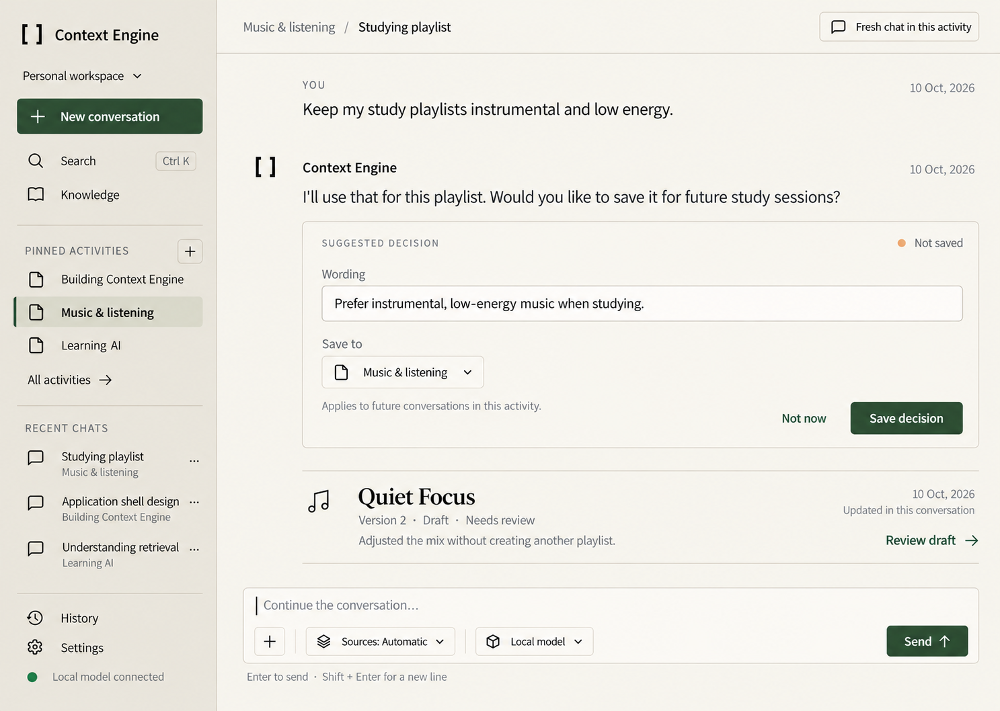
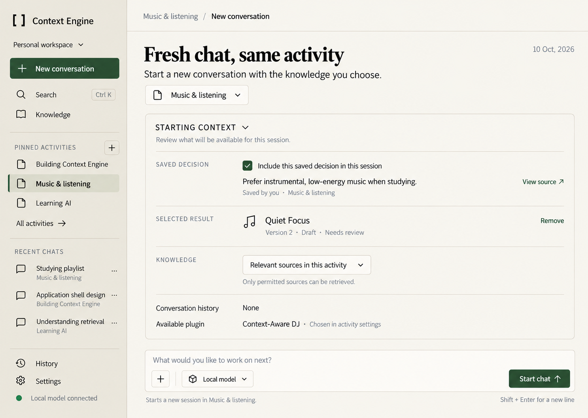
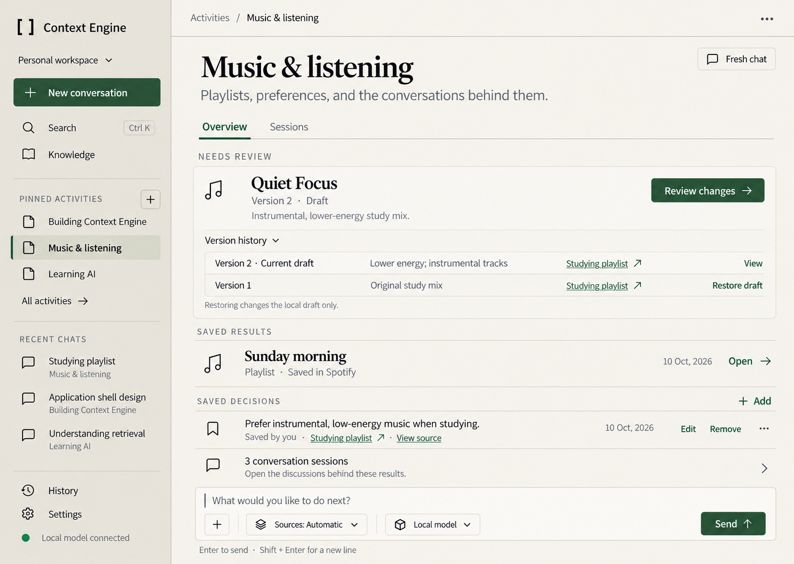
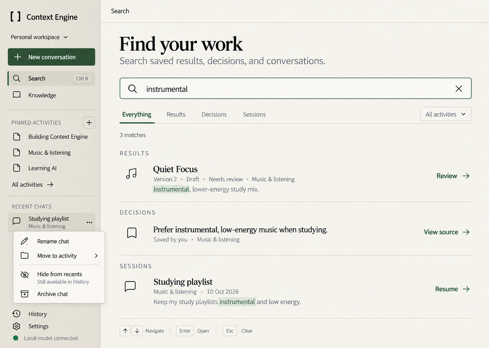

# First Prototype Design

These mockups explore a first Context Engine application shell and how it could keep conversations manageable. They are design concepts, not implemented or validated interface behavior.

The direction uses a warm, restrained visual style with a short sidebar: a few pinned activities, the latest chats, and global search. Activities collect durable results and user-approved decisions; new conversations can start with selected context. Plugins are chosen for each activity and configured in Settings, where their context access, external actions, and connections are managed.

## Screens

### Save a decision

A conversation proposes a reusable preference. The user can edit its wording, choose the activity it belongs to, and explicitly save it. A playlist update stays linked to the existing result as a new version.

### Start a fresh conversation with context

Before starting a new session, the user can review the saved decision, selected result, allowed knowledge sources, conversation history, and plugins available in the activity.

### Review activity results and versions

The activity overview puts work needing review first, keeps earlier result versions accessible, and shows saved results and decisions with their source conversations.

### Search and manage chats

Search returns matching results, decisions, and conversations together. A chat can be renamed, moved, hidden from recents, or archived; hiding it from recents does not remove it from History.

